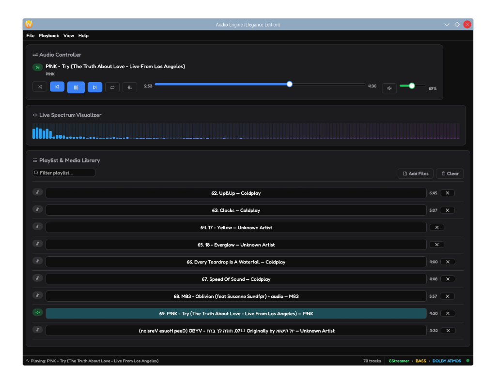
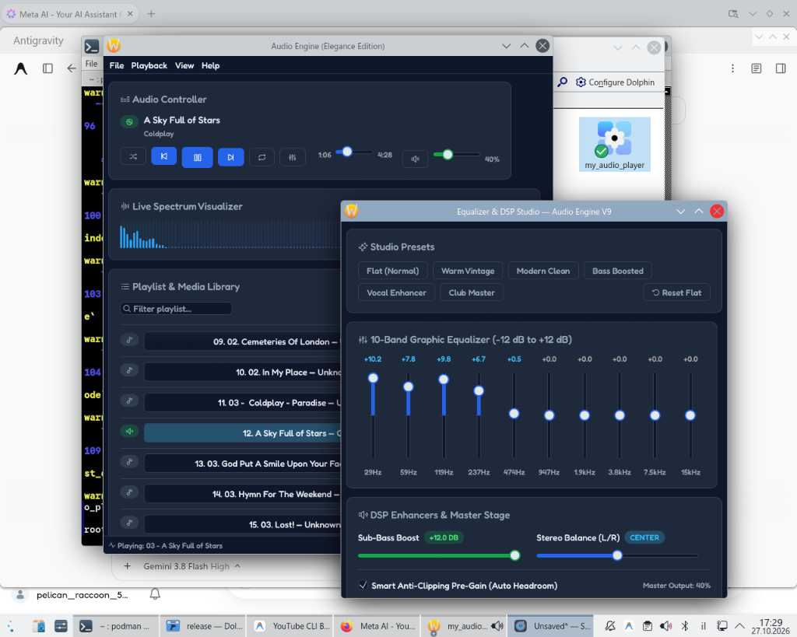

# 🎵 Audio Engine (Elegance Edition) — V9

[](https://www.rust-lang.org/)
[](https://github.com/emilk/egui)
[](https://gstreamer.freedesktop.org/)
[](#license)

**Audio Engine (Elegance Edition)** is a high-performance, studio-grade desktop audio player and DSP suite written in **Rust**.  
Combining a sleek, modern dark-mode GUI powered by `egui` with a zero-latency audio pipeline built on `GStreamer`, it delivers audiophile-grade playback, real-time 64-band spectrum visualization, an interactive 10-band equalizer, and intelligent anti-clipping headroom management.



---

## ✨ Features

- 🎧 **Audiophile DSP & Equalizer Studio**:
  - **10-Band Graphic Equalizer** with frequency points tuned to standard octaves: `29 Hz`, `59 Hz`, `119 Hz`, `237 Hz`, `474 Hz`, `947 Hz`, `1.9 kHz`, `3.8 kHz`, `7.5 kHz`, and `15 kHz`.
  - **Studio Presets**: Instant one-click presets including *Flat*, *Warm Vintage*, *Modern Clean*, *Bass Boosted*, *Vocal Enhancer*, and *Club Master*.
  - **Smart Anti-Clipping Pre-Gain (Auto Headroom)**: Dynamically calculates required headroom to prevent digital distortion and harmonic clipping when boosting EQ bands.
  - **Sub-Bass Enhancer & Stereo Balance**: Low-end punch booster up to +12 dB with smooth L/R pan control.
- 〰️ **Real-Time Spectrum Visualizer**:
  - Live frequency spectrum analysis running at 60 FPS directly within the main player view.
  - Dynamic smooth gradient rendering transitions from cyan/turquoise to neon magenta.
- 📜 **Seamless Playlist & Media Library**:
  - Drag-and-drop audio files or entire directories on the fly.
  - Real-time search and filter with instant results.
  - Automatic metadata tag reading (Title, Artist, Album, Duration).
  - Context menu actions, quick track removal, and persistent playback state across launches.
- 🎛️ **Universal Audio Codec Support**:
  - Plays MP3, FLAC, WAV, OGG, M4A, AAC, Opus, and more through GStreamer's native `decodebin`.

---

## 🎚️ Equalizer & DSP Studio

The DSP Equalizer runs in a dedicated studio window for precision sound tweaking:



---

## 🏗️ Architecture

```text
my_audio_player/
├── assets/          # Custom typography & showcase screenshots
└── src/
    ├── audio.rs     # GStreamer pipeline, 10-band EQ filters, volume, and spectrum bus
    ├── menu.rs      # Top application menu bar (Theme picker, Presets, File Dialogs)
    └── main.rs      # egui UI layout, visualizer rendering, playlist management
```

### Audio Pipeline Flow


---

## 🚀 Building from Source

### System Requirements (Linux)

Ensure **GStreamer 1.0** development packages and plugins are installed:

#### Ubuntu / Debian / Pop!_OS:
```bash
sudo apt-get install -y \
    build-essential pkg-config \
    libgstreamer1.0-dev libgstreamer-plugins-base1.0-dev \
    gstreamer1.0-plugins-base gstreamer1.0-plugins-good \
    gstreamer1.0-plugins-bad gstreamer1.0-plugins-ugly
```

#### OpenMandriva / Fedora / RHEL:
```bash
sudo dnf install \
    gstreamer1-devel gstreamer1-plugins-base-devel \
    gstreamer1-plugins-good gstreamer1-plugins-bad-free gstreamer1-plugins-ugly-free
```

### Build & Run

```bash
# Clone the repository
git clone https://github.com/leumicard-code/my_audio_player.git
cd my_audio_player

# Build optimized release binary
cargo build --release

# Launch the player
./target/release/my_audio_player
```

---

## ⌨️ Shortcuts & Controls

| Action | Shortcut / Gesture |
| :--- | :--- |
| **Play / Pause** | `Space` |
| **Seek Forward / Backward** | `Right Arrow` / `Left Arrow` |
| **Reset EQ Band Slider** | `Double Click` on any slider |
| **Quick Play Track** | `Double Click` track in playlist |
| **Track Context Menu** | `Right Click` on track (Play / Remove) |
| **Open Equalizer Studio** | Click the **EQ** button in the Audio Controller |

---

## 👤 Author

**Shay Kadosh** — System Architect & Lead Developer  
*Built with love 🥰 DEV-TEAM ™*

## 📄 License

This project is licensed under the [MIT License](LICENSE).
